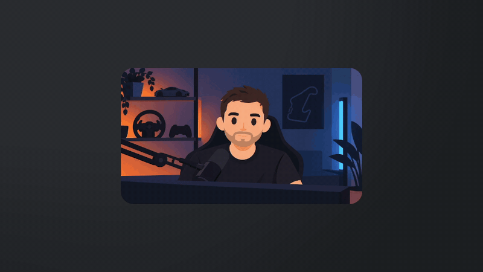
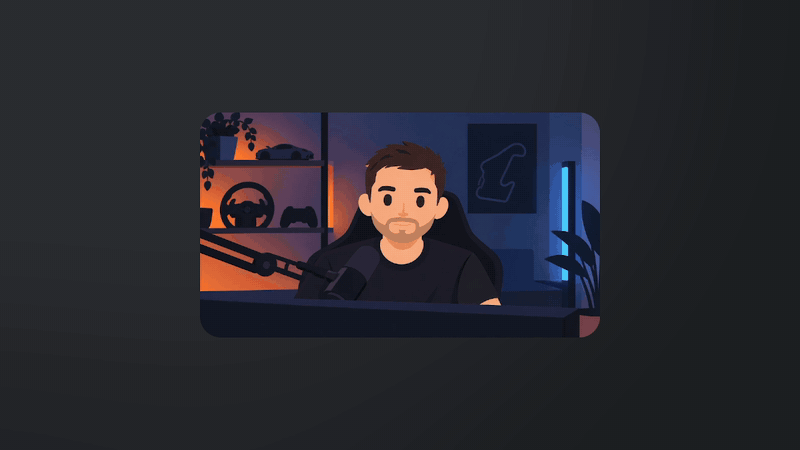
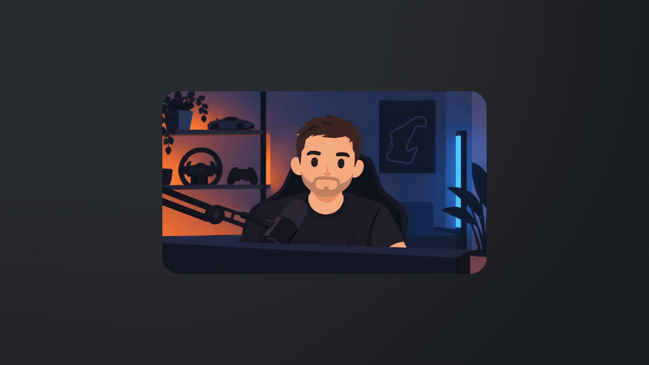
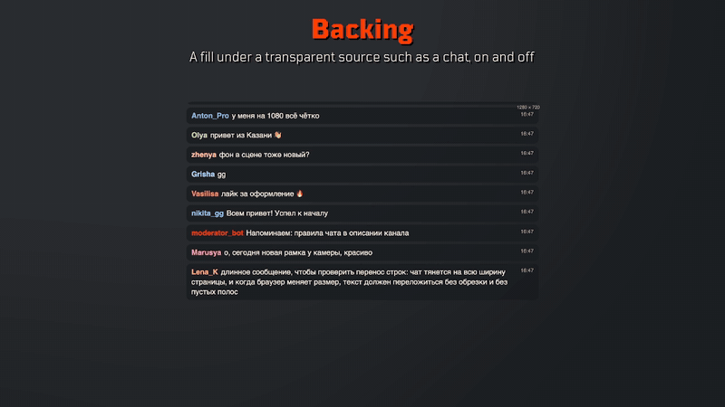
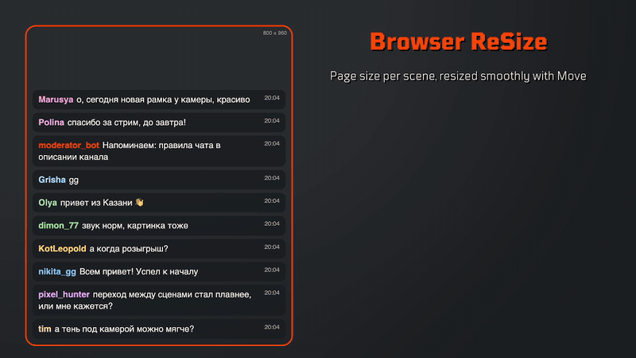

# OBS Plugins by Vakovsky

[English](README.md) · Русский

   

Два плагина для OBS Studio. У каждого свои релизы.

## Ultimate Frame

Фильтр скругляет углы источника и добавляет обводку, тень, подложку, обрезку, зум и затухание к краям. У каждой сцены может быть свой вид, и при переключении через [Move](https://obsproject.com/forum/resources/move.913/), Fade или Cut фильтр плавно переводит один вид в другой.

Размеры задаются в пикселях холста. Обводка 3 px остаётся 3 px и у камеры на весь экран, и у маленькой камеры в углу.

Внешняя обводка и тень выходят за край источника. Для элементов, которые появляются и исчезают в Move, выберите переход «Затухание для Ultimate Frame» из комплекта: обычный Fade их обрезает.

<table>
<tr>
<td width="50%"> Профили по сценам</td>
<td width="50%"> Обрезка по сценам</td>
</tr>
<tr>
<td> Скруглённые углы</td>
<td> Радиус каждого угла</td>
</tr>
<tr>
<td> Внутренняя обводка</td>
<td> Внешняя обводка</td>
</tr>
<tr>
<td> Градиент</td>
<td> Свечение</td>
</tr>
<tr>
<td> Тень</td>
<td> Внутренняя тень</td>
</tr>
<tr>
<td> Зум и смещение внутри рамки</td>
<td> Подложка под прозрачным источником</td>
</tr>
</table>

Чтобы начать, добавьте Ultimate Frame последним фильтром источника, включите «Разные настройки для каждой сцены», выберите сцену в «Редактировать профиль» и настройте её вид.

## Browser ReSize (бета)

У браузерного источника, например чата, на каждой сцене свой размер страницы. Страница заново раскладывается под новый размер, поэтому текст не растягивается.

С галочкой «Плавное изменение размера (для Move)» страница растёт вместе с анимацией Move. Для Fade и других переходов её лучше снять.

Статичная страница, например чат без новых сообщений, может не перерисоваться после смены размера. Поэтому фильтр дописывает в конец пользовательского CSS источника маленькую невидимую анимацию. Ваш CSS не меняется. Чтобы убрать анимацию, снимите «Постоянная перерисовка страницы».

## Установка

OBS Studio 31 или новее. Закройте OBS и скачайте файл для своей системы в [Releases](https://github.com/VakovskyGT/vakovsky-obs-plugins/releases).

- Windows 10 или 11: запустите `windows-x64-installer.exe`. Он сам найдёт установленный OBS или спросит папку портативного, положит плагин туда, откуда его загружает эта версия OBS, и удаляется в «Установленных приложениях». Установщик не подписан, поэтому Windows SmartScreen может предупредить: нажмите «Подробнее», затем «Выполнить в любом случае». Или поставьте вручную: распакуйте zip в `C:\ProgramData\obs-studio\plugins\` (`windows-x64.zip` для OBS 33 и новее, `windows-legacy-x64.zip` для OBS 31 и 32).
- macOS: положите папку `.plugin` из архива в `~/Library/Application Support/obs-studio/plugins/`. Плагин не подписан, и macOS может его заблокировать. Тогда один раз выполните в Терминале: `xattr -r -d com.apple.quarantine ~/Library/Application\ Support/obs-studio/plugins/ultimate-frame.plugin` (или `browser-resize.plugin`).

Раз в сутки плагины смотрят на GitHub, нет ли новой версии, и показывают ссылку в свойствах фильтра. Сами они ничего не скачивают.

## Ограничения

- Ultimate Frame должен стоять последним. Фильтры после него обрезают внешнюю обводку и тень.
- У элементов с Alt-обрезкой, фильтром масштабирования или режимом смешивания работают только углы и внутренние эффекты: OBS обрезает их картинку по краю. Фильтр пишет, в каких сценах это так.
- На сцене, которая используется как источник, внешняя обводка и внешняя тень по той же причине выключены. Чтобы они работали, добавьте сцену через [Source Clone](https://obsproject.com/forum/resources/source-clone.1632/) и поставьте Ultimate Frame на клон. Ставьте клон во всех сценах: Move считает клон и его сцену одним элементом и меняет их на середине перехода.
- Настройки по сценам не работают на группе: в каждой сцене своя её копия.
- Browser ReSize ждёт кадр без чёрных полос по краям, поэтому страница с чёрной рамкой может показать новый размер с опозданием.

Нашли ошибку? Напишите в [Issues](https://github.com/VakovskyGT/vakovsky-obs-plugins/issues).

## Автор

Сделал [Vakovsky](https://www.twitch.tv/vakovsky). Если плагины пригодились, меня можно поддержать на [DonationAlerts](https://www.donationalerts.com/r/vakovsky) или [Boosty](https://boosty.to/vakovsky).

Лицензия: [GPL-2.0-or-later](../LICENSE)
